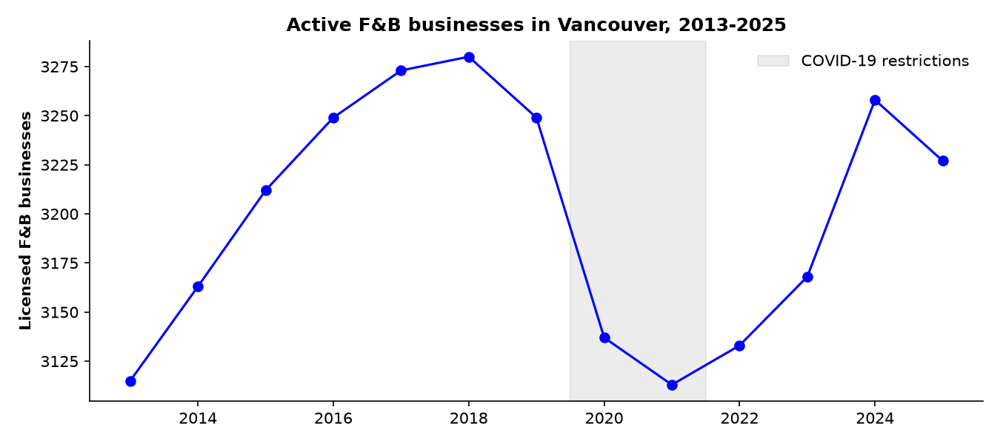
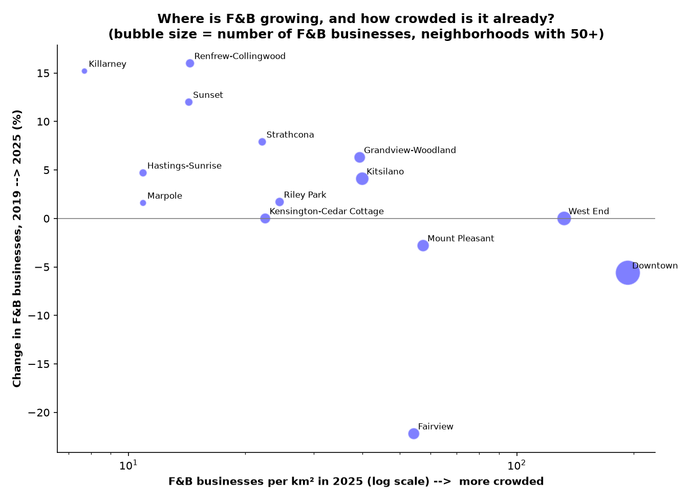

# Vancouver F&B Expansion Analysis

*by Jane Le: in progress (started October 2 2026)*

**Where in Vancouver is there room for one more restaurant?** This project uses City of Vancouver open data to help a fictional hospitality group choose where to open its next dining and lounge concept.

## Why this project

Before starting university at the ripe age of 24 for my Bachelor's of Data Science, I worked in the food & beverage operations, including two years supervising F&B operations at the Vancouver Convention Centre. That gave me a feel for the operations side of the industry. With this project I wanted to look at it from the market side: where do restaurants open, survive and close across the city, and what can public data say about it?

## The business case

*Pacific Horizons Hospitality Group (PHHG)* (fictional) is planning a new multi-location dining and lounge concept for late 2026. Leadership is considering between:
- **Traditional districts** (Downtown, Yaletown) have the crowds, but also high costs and heavy competition.
- **Emerging residential areas** (Mount Pleasant, Grandview-Woodland, Hastings-Sunrise) are changing fast, but are they ready?

The goal is to recommend the **top two neighbourhoods** for the rollout.

## Part 1 (done): Competition and growth by neighbourhood

[`notebooks/01_fnb_licences_by_neighbourhood.ipynb`](notebooks/01_fnb_licences_by_neighbourhood.ipynb)

Using about 920,000 business licence records (2013-2026), I counted active restaurants, cafes and bars in each of Vancouver's 22 neighbourhoods and measured growth, density and closure rates.

**My early findings**
- **Downtown is already very crowded, and it's shrinking.** It has the most F&B businesses (898) and the most per km2 (about 193), but 5.6% fewer than in 2019.
- **Mount Pleasant grew a lot before Covid (+18% from 2015 to 2019), but not since.**
- **Grandview-Woodland and Strathcona are growing steadily without being crowded.** Both grew over the last 10 years (+16%, +26%) and since Covid (+6%, +8%), and Downtown has 5 to 9 times more F&B businesses per km2 than they do. Based on competition alone, these are my two early picks.
- **The fastest growth is in East Vancouver neighbourhoods further from downtown** (Renfrew-Collingwood +16% since 2019), but they started with only a few F&B businesses. My next steps for this project will look at customer activity to see if the customers are there.

## Data challenges I solved

| Problem | Why it mattered | What I did |
|---|---|---|
| Licence year 2024 appeared in two source files (~57000 overlapping licences) | Every 2024 business would have been counted twice | Kept 2024 only from the newer export, then checked that each year appears once |
| The City renamed its business categories in 2024 | A filter on one naming scheme drops the other years (silently) | Mapped old category names to new ones, and confirmed the city-wide count stays smooth across the change |
| The older licence file has no neighbourhood column | Can't compare neighbourhoods | Used each business's coordinates and the City's neighbourhood boundary shapes to assign it a neighbourhood (point-in-polygon) with 95.7% matched |
| Year stored as two-digit text ("97","05") | Sorting put 2000-2012 before the 1990s | Converted it to a numeric four-digit year |

## Next steps
- [ ] **customer activity:** use parking tickets from 2011-2026 (about 6 million records) as a rough measure of how busy each area is, matched to neighbourhoods by street and block
- [ ] **future growth:** use building permits to see where new construction is happening
- [ ] **recommendation:** combine competition and customer activity into one score, and make the final top-two recommendation

## Limitations
- I didn't use population data by neighbourhood: the newest census data by neighbourhood on the City's website is from 2016, which is before Covid, and post-covid change is what this project is about.
- An issued licence is my best available sign that a business was open, but it isn't proof.
- Some active licences have no coordinates and therefore are excluded from the neighbourhood counts.

## Data sources
All data comes from the [City of Vancouver Open Data Portal](https://opendata.vancouver.ca/). The raw files are too large for GitHub (over 100 MB each), so download them into `data/raw/` to reproduce:
- [Business licences 2013–2024](https://opendata.vancouver.ca/explore/assets/business-licences-2013-to-2024/)
- [Business licences 2024–2026](https://opendata.vancouver.ca/explore/assets/business-licences/)
- [Local area boundaries](https://opendata.vancouver.ca/explore/dataset/local-area-boundary/)

## Tools
Python (pandas, NumPy, Matplotlib), Jupyter, VS Code, Git/GitHub
